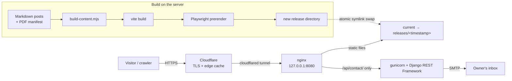

# AlgoMate

**The production website of my tutoring business — live at [algomate.ro](https://algomate.ro).**

AlgoMate is a one-person business teaching mathematics and computer science
(C++) to Romanian students preparing for the Bacalaureat and the Evaluarea
Națională. I'm the instructor, and I designed, built and operate everything in
this repository: the site, the content pipeline, the server and the deploys.

The site's job is to let a student or a parent decide whether to get in touch.
It runs on a single Linux server behind Cloudflare, publishes a weekly blog of
worked exam solutions, hosts free PDF study guides, and takes enrolment
requests through a small Django API.

<p>
  
  
  
  
  
  
  
</p>

---

## Contents

- [Architecture](#architecture)
- [Engineering highlights](#engineering-highlights)
- [Production incidents and what changed](#production-incidents-and-what-changed)
- [Repository layout](#repository-layout)
- [Running it locally](#running-it-locally)
- [Deploying](#deploying)
- [Documentation](#documentation)

---

## Architecture

The site is a **fully prerendered static build**. Every page a visitor or a
crawler receives is finished HTML produced at build time; React then hydrates
it for navigation and interaction. The only dynamic code is one endpoint,
`POST /api/contact/`, which emails an enrolment request to me.



Nothing on the server listens on a public interface for this site: Cloudflare
terminates TLS and reaches nginx through an outbound tunnel. There are no user
accounts, sessions, cookies or stored personal data.

| Layer | Technology |
| --- | --- |
| Frontend | React 19, TypeScript, Vite 7, Tailwind CSS v4, Framer Motion, React Router 7 |
| Content | Markdown + front matter (`gray-matter`, `marked`), KaTeX, `sanitize-html` |
| Prerendering | Playwright (headless Chromium) over an Express static server |
| Backend | Django 6, Django REST Framework, gunicorn |
| Hosting | Ubuntu 24.04, nginx, systemd, Cloudflare + `cloudflared` |

---

## Engineering highlights

### A build-time content pipeline

Blog posts are Markdown files in [`frontend/content/posts/`](frontend/content/posts).
[`scripts/build-content.mjs`](frontend/scripts/build-content.mjs) compiles them
at build time:

- validates each post's front matter, cover image and LaTeX, and fails the
  build with a precise message on a bad one;
- renders LaTeX to static KaTeX markup, so no maths JavaScript ships to the browser;
- sanitises the rendered HTML against an explicit allow-list before it ever
  reaches `dangerouslySetInnerHTML`, and marks external links `noopener noreferrer`;
- holds back posts dated in the future, which is what makes scheduled
  publishing possible;
- generates the sitemap, a full-text RSS feed, `llms.txt`, `security.txt` and
  the list of routes to prerender;
- takes each static page's sitemap `<lastmod>` from the **git history of its
  source files**, not the build date, so the field stays meaningful to
  crawlers across weekly rebuilds.

The free PDF guides work the same way: a typed manifest
([`src/config/resources.ts`](frontend/src/config/resources.ts)) describes them,
file sizes are read from disk, and a manifest entry without a file fails the
build.

### Prerendering that is safe for search engines

[`prerender.js`](frontend/prerender.js) loads every route in headless Chromium
and saves the resulting DOM as static HTML, plus a real `404.html`. It emulates
`prefers-reduced-motion: reduce`, and the components are written so that their
finished content is present under that setting: animated headings render their
full text, and accordions keep every answer in the DOM and hide it with CSS.
Both rules came out of real indexing defects (see
[incidents](#production-incidents-and-what-changed)).

### Atomic, zero-downtime deploys

[`deploy/rebuild.sh`](deploy/rebuild.sh) never builds into the directory nginx
serves. It builds into a fresh timestamped release, then:

1. **verifies** it — required files present, the homepage actually
   prerendered, every script and stylesheet the homepage references present;
2. **carries forward** the previous release's hashed assets for 14 days, so a
   browser tab opened before the deploy can still load the code-split chunks
   its HTML refers to;
3. **publishes** by replacing a `current` symlink with a single `rename(2)`,
   so no request can see a half-built site.

A failed build never goes live, and a rollback is one symlink swap with no
rebuild.

### Scheduled publishing

A systemd timer ([`deploy/systemd/`](deploy/systemd)) runs
[`publish-scheduled.sh`](deploy/publish-scheduled.sh) every morning. It
compares the routes that *should* exist today with what the live release
contains, and deploys only when a post has come due — so a missed morning (the
server was off) cannot lose a post. It refuses to run over uncommitted or
unpushed work rather than silently resetting it, and notifies search engines
of new URLs through IndexNow.

### Performance

- **Route- and post-level code splitting.** The site used to ship as one
  1.76 MB script containing every page and every article. Each page and each
  post body is now its own chunk, and the homepage loads about 155 kB of
  gzipped script — a figure that no longer grows as articles are added.
- **Stable vendor chunks.** React, Framer Motion and the icon set are split
  out, so a weekly content deploy doesn't invalidate them in returning
  visitors' caches.
- **Self-hosted fonts**, with the two above-the-fold faces preloaded by a small
  Vite plugin. The site makes **no third-party requests at all**.
- **Caching by URL** in nginx: hashed assets are immutable for a year, PDFs and
  images are cached for a week, HTML is revalidated on every request.

### Security

I ran a security audit of the whole stack and recorded it in
[`docs/SECURITY.md`](docs/SECURITY.md): twelve findings, each with its cause
and fix. Among them:

- **Rate limiting was global, not per visitor.** Every request reached nginx
  through the tunnel from `127.0.0.1`, so the contact form's limit was one
  shared bucket for the whole internet. nginx now restores the real client IP
  from Cloudflare's header, and Django throttles per visitor *and* per email
  address.
- **Headers set once, at the server level:** HSTS, a strict
  Content-Security-Policy (possible because nothing is loaded from a third
  party), `X-Frame-Options`, `Referrer-Policy`, `Permissions-Policy` and COOP.
  Plain HTTP redirects to HTTPS.
- **A sandboxed backend.** The gunicorn unit runs with a read-only filesystem,
  no capabilities and no privilege escalation; secrets are readable by the
  service user only.
- **A hardened form endpoint:** JSON-only parsers, no browsable API, a
  honeypot field, a request body cap, and control characters in the name
  rejected with a `400` instead of surfacing as a `500` from the mailer.

### A test that runs against production

[`scripts/check-live-seo.mjs`](frontend/scripts/check-live-seo.mjs) probes the
live site as Googlebot after every deploy and nginx change, and exits non-zero
on failure. It checks that:

- `robots.txt` allows crawling and the sitemap is valid;
- every sitemap URL answers `200` directly, with a matching canonical;
- unknown URLs return a real `404`, not a soft 404;
- redirects stay on the public origin;
- the security headers are present and HTTP redirects to HTTPS;
- the homepage's assets load with the right cache headers;
- the contact API is up.

It has caught two production bugs that a build could not have seen, because
both lived in the web server's configuration rather than in the code.

### SEO with one source of truth

Pages carry JSON-LD structured data (`EducationalOrganization`, `Person`,
`Course`, `FAQPage`, `BlogPosting`, `BreadcrumbList`). Prices and contact
details come from one config file ([`src/config/pricing.ts`](frontend/src/config/pricing.ts),
[`src/config/contact.ts`](frontend/src/config/contact.ts)), which the visible
copy, the meta descriptions and the schema all import. Structured data can't
drift out of sync with what the page says.

---

## Production incidents and what changed

Each of these reached production, was diagnosed from the symptom back to the
cause, and left behind a guard so that it cannot quietly come back.

| Symptom | Root cause | Fix and guard |
| --- | --- | --- |
| Search Console: *"Server error (5xx)"* | The site was rebuilt in place, so `vite build` emptied the directory nginx was serving while a crawler visited | Atomic symlink deploys with pre-publish verification |
| Every unknown URL returned `200` (soft 404s) | An SPA fallback (`try_files $uri /index.html`) on a site that is fully prerendered | Fallback removed, prerendered `404.html` served with a real 404 status, asserted by the live check |
| Redirects pointed at `http://…:8080` | nginx built absolute redirects from its internal listen port behind the tunnel | `absolute_redirect off`, asserted by the live check |
| The prerendered `<h1>` contained a half-typed word | A typewriter animation was snapshotted mid-animation | Animated text renders its final state under reduced motion; the prerenderer emulates it |
| Six of seven FAQ answers were missing from the HTML | The accordion unmounted closed panels | Native `<details>`; all content stays in the DOM |
| The contact form could be blocked for everyone | Rate limit keyed on the tunnel's loopback address | Real client IP from Cloudflare; per-visitor and per-email throttles |

---

## Repository layout

```
backend/                 Django + DRF — one endpoint, POST /api/contact/
  core/views.py          rate-limited contact handler
  core/tests.py          endpoint tests (no database, in-memory mail)
frontend/
  content/posts/         blog posts as Markdown — the source of truth
  public/descarcari/     free PDF study guides (versioned filenames)
  scripts/               content compiler, live production check, cover-image,
                         font and icon generators, IndexNow client
  prerender.js           Playwright static prerenderer
  src/
    pages/               one lazily loaded chunk per route
    components/          shared UI, SEO component
    config/              pricing, contact details, resource manifest
    seo/                 JSON-LD builders
deploy/
  rebuild.sh             atomic deploy
  publish-scheduled.sh   daily scheduled-post publisher
  nginx/                 reference copies of the live nginx config
  systemd/               backend service, publish timer
docs/                    runbooks and design records
```

---

## Running it locally

**Requirements:** Node.js 20+, Python 3.12+.

### Frontend

```bash
cd frontend
npm ci
npm run dev        # compiles content, then starts Vite on http://localhost:5173
npm run build      # content → type-check → production build → prerender
npm run lint
```

The first `npm run build` needs a browser for the prerenderer:
`npx playwright install chromium`.

### Backend

```bash
cd backend
python -m venv venv && source venv/bin/activate
pip install -r requirements.txt
cp .env.example .env               # fill in SECRET_KEY; set DEBUG=True locally
python manage.py runserver

SECRET_KEY=test python manage.py test
```

To point a local frontend at a backend running elsewhere, set `VITE_API_URL`.

### Writing a post

Add a Markdown file to `frontend/content/posts/` with the front matter described
in [`docs/PUBLISHING-POSTS.md`](docs/PUBLISHING-POSTS.md), then generate its
cover image:

```bash
node scripts/make-cover.mjs --out public/blog/<slug>.jpg --kicker "BAC 2027" --title "…" --mark "∫"
```

A post dated in the future stays unpublished until its date, when the morning
timer deploys it.

---

## Deploying

Production tracks `main`. A deploy is one command on the server, followed by
the live check:

```bash
sudo -u razvan /srv/algomate-deploy/bin/rebuild.sh
node frontend/scripts/check-live-seo.mjs https://algomate.ro
```

Rolling back means pointing the `current` symlink at an earlier release.
[`deploy/INSTALL.md`](deploy/INSTALL.md) has the exact commands.

---

## Documentation

The `docs/` directory is written for whoever maintains the site next, including
me in six months. Each document records why a decision was made, not just what
was done.

| Document | Covers |
| --- | --- |
| [`SERVER-SETUP.md`](docs/SERVER-SETUP.md) | Server state, the live nginx config, and the two indexing bugs it fixed |
| [`SECURITY.md`](docs/SECURITY.md) | The security audit: findings, fixes, and how to re-verify them |
| [`SEO.md`](docs/SEO.md) | Search strategy, the defects found and fixed, and invariants to preserve |
| [`PUBLISHING-POSTS.md`](docs/PUBLISHING-POSTS.md) | How a post goes from a Markdown file to a live page |
| [`DOWNLOADS-SECTION.md`](docs/DOWNLOADS-SECTION.md) | Design record for the free study-guide downloads |
| [`PRODUCT.md`](PRODUCT.md) | Who the site is for, its voice, and its design principles |

---

## About

Built and run by **Răzvan Rădulescu**, Politehnică graduate,
programmer, former national informatics olympian, and the person who teaches the
lessons.

The source is public for review. The site's copy, articles, study guides and
branding belong to AlgoMate and are not licensed for reuse.
