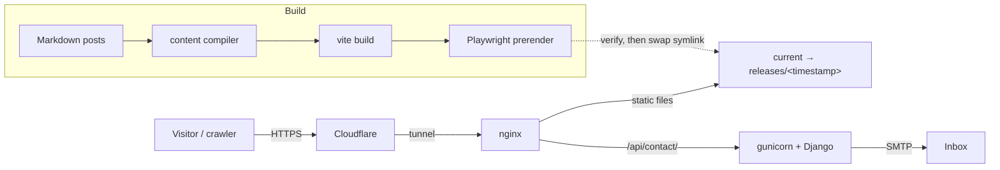
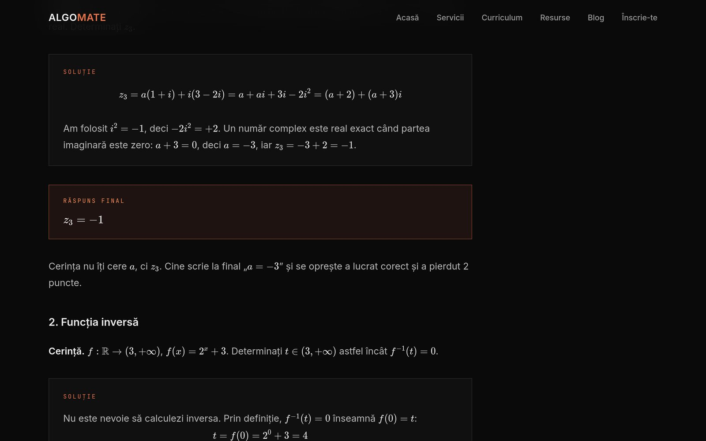

# AlgoMate

The website of my tutoring business, live at **[algomate.ro](https://algomate.ro)**.

I teach mathematics and C++ to Romanian students preparing for the
Bacalaureat and the national 8th-grade exam. I also built this site and run it
in production on my own server. It brings in students, publishes a weekly blog
of worked exam solutions, offers free PDF study guides, and sends enrolment
requests to my inbox.

<p align="center">
  
</p>

**Stack:** React 19 · TypeScript · Vite · Tailwind CSS v4 · Playwright ·
Django REST Framework · nginx · systemd · Cloudflare Tunnel

| | |
| --- | --- |
| Content | 22 pages and 9 PDF study guides, every page prerendered to static HTML |
| Homepage JavaScript | ~157 kB gzipped, down from a 282 kB single bundle |
| Deploys | Atomic symlink swap, verified before going live, one-command rollback |
| Production test | 82 checks run against the live site after every deploy |
| Security | Full-stack audit: 12 findings, each with its cause and fix documented |
| Backend tests | 23 tests for the contact endpoint: validation, throttling, header injection |

---

## How it works

Every page is rendered to HTML at build time. A visitor or a crawler gets
finished markup, and React hydrates it for navigation. The only server-side
code is `POST /api/contact/`, which emails an enrolment request.



The server has no public ports for this site. Cloudflare terminates TLS and
reaches nginx through an outbound tunnel. There are no accounts, cookies or
stored personal data.

---

## Engineering decisions

### Deploys that can't take the site down

My first deploy script built in place. `vite build` empties the output
directory, and a crawler that arrived during that window got a 500. Google
Search Console then reported pages excluded from the index for server errors.

[`deploy/rebuild.sh`](deploy/rebuild.sh) now builds into a new timestamped
release. Before publishing, it checks that the required files are there, that
the homepage was actually prerendered, and that every script and stylesheet the
homepage references is present. It then replaces the `current` symlink with a
single `rename(2)`. A failed build never goes live, and rolling back is one
symlink swap.

Hashed assets from the outgoing release are kept for 14 days. A tab opened
before a deploy can still load the code-split chunks its HTML refers to.

### Prerendering that search engines read correctly

[`prerender.js`](frontend/prerender.js) loads each route in headless Chromium
and saves the DOM. Two bugs showed what that snapshot has to contain:

- The `<h1>` was saved halfway through a typewriter animation, as a half-typed
  word.
- Six of seven FAQ answers were missing, because the accordion unmounted closed
  panels.

The prerenderer now emulates `prefers-reduced-motion`, and components render
their final content under it. The FAQ uses native `<details>`, so every answer
stays in the DOM.

### A content pipeline that fails loudly

Posts are Markdown files. [`build-content.mjs`](frontend/scripts/build-content.mjs)
compiles them at build time:

- It validates front matter, cover images and LaTeX, and stops the build with a
  precise error.
- It renders maths to static KaTeX markup, so no maths library ships to the
  browser.
- It sanitises the generated HTML against an allow-list before it reaches
  `dangerouslySetInnerHTML`.
- It holds back posts dated in the future. A systemd timer publishes them on
  their morning, and catches up after a missed run.
- It generates the sitemap, an RSS feed and the list of routes to prerender.
- Each sitemap `<lastmod>` is the date of the last git commit to that page's
  source files, not the build date. A weekly rebuild does not mark every page
  as changed.

<p align="center">
  
</p>

### Testing production, not only the build

Some bugs only exist in the server configuration, so a build can't catch them.
[`check-live-seo.mjs`](frontend/scripts/check-live-seo.mjs) requests the live
site as Googlebot after every deploy and exits non-zero on any failure. It
checks that:

- every sitemap URL returns `200` with a matching canonical;
- unknown paths return a real `404`;
- redirects stay on the public origin;
- the security headers are set and assets are cached correctly;
- the API is reachable.

It caught two production bugs:

- An SPA fallback answered every unknown URL with `200`, so search engines saw
  soft 404s.
- nginx built redirects to `http://…:8080`, its internal port behind the
  tunnel.

### Security

I audited the whole stack and recorded each finding, its cause and its fix in
[`docs/SECURITY.md`](docs/SECURITY.md). The most interesting one: every request
reached nginx from `127.0.0.1` through the tunnel, so the contact form's rate
limit was one bucket shared by the whole internet. One person could block the
form for everybody. nginx now restores the client address from Cloudflare's
header, and Django throttles per visitor and per email address.

The audit also added:

- HSTS and a strict Content-Security-Policy;
- an HTTP-to-HTTPS redirect;
- a sandboxed systemd unit for gunicorn (read-only filesystem, no
  capabilities);
- a request body cap and a honeypot on the form endpoint.

### Performance

The site used to ship one 1.76 MB script (282 kB gzipped) containing every page
and every article. Each route and each post body is now its own chunk. React,
Framer Motion and the icons are split into vendor chunks that stay cached
across content deploys. The homepage loads about 157 kB of gzipped script, and
that number no longer grows with the number of articles. Fonts are self-hosted,
and the two above-the-fold faces are preloaded.

### One source of truth for prices and contact details

Pages carry JSON-LD structured data (`EducationalOrganization`, `Course`,
`FAQPage`, `BlogPosting` and others). Prices and contact details live in
[`pricing.ts`](frontend/src/config/pricing.ts) and
[`contact.ts`](frontend/src/config/contact.ts). The visible copy, the meta
descriptions and the structured data all import from those two files, so they
can't disagree.

---

## Repository layout

```
backend/            Django + DRF: POST /api/contact/ and its tests
frontend/
  content/posts/    blog posts (Markdown)
  public/descarcari/ free PDF study guides
  scripts/          content compiler, live production check, asset generators
  prerender.js      Playwright prerenderer
  src/              pages, components, config, JSON-LD builders
deploy/             deploy and publish scripts, nginx and systemd reference configs
docs/               runbooks and design records
```

## Running locally

Requires Node.js 20+ and Python 3.12+.

```bash
# Frontend
cd frontend
npm ci
npx playwright install chromium   # needed once, for the prerender step
npm run dev                       # http://localhost:5173
npm run build                     # content → type-check → build → prerender

# Backend
cd backend
python -m venv venv && source venv/bin/activate
pip install -r requirements.txt
cp .env.example .env              # set SECRET_KEY; DEBUG=True locally
python manage.py runserver
SECRET_KEY=test python manage.py test
```

## Deploying

```bash
sudo -u razvan /srv/algomate-deploy/bin/rebuild.sh
node frontend/scripts/check-live-seo.mjs https://algomate.ro
```

Rollback steps are in [`deploy/INSTALL.md`](deploy/INSTALL.md).

## Documentation

Each document in [`docs/`](docs) records the reasons behind a decision, not only
the steps.

- [`SERVER-SETUP.md`](docs/SERVER-SETUP.md): server state and the nginx configuration
- [`SECURITY.md`](docs/SECURITY.md): the security audit and how to re-verify it
- [`SEO.md`](docs/SEO.md): search strategy, defects found, invariants to keep
- [`PUBLISHING-POSTS.md`](docs/PUBLISHING-POSTS.md): from a Markdown file to a live page
- [`DOWNLOADS-SECTION.md`](docs/DOWNLOADS-SECTION.md): design record for the study guides

---

Built and run by **Răzvan Rădulescu**, an undergraduate at the National
University of Science and Technology POLITEHNICA Bucharest.

The code is public for review. The site's text, articles, study guides and
branding belong to AlgoMate and are not licensed for reuse.
